 

 

---

## 🧭 Qué hago

Coordino al equipo de desarrollo de **Cloud Tecnologies**, donde trabajo desde octubre de 2024, y construyo productos propios de la firma. Diseño sistemas con fundamentos de ingeniería y uso la IA generativa como parte del equipo, no como atajo.

| Producto | Qué es | Enlace |
|:--|:--|:--|
| 🛡️ **NISTrack** | Plataforma SaaS de cumplimiento en ciberseguridad | [nistrack.com](https://www.nistrack.com) |
| 🌡️ **Termómetro** | Herramienta pública de la empresa | [termometro.cloud-tecnologies.pe](https://termometro.cloud-tecnologies.pe) |
| 🏢 **ERP interno** | Sistema interno de la empresa, desarrollado con orquestación de agentes de IA | Privado |

> El código de estos productos es privado, por eso en mi perfil público ves pocos repositorios. Con gusto muestro el trabajo en una conversación.

---

## 🧰 Stack

**Desarrollo** 

**DevOps y herramientas** 

**Seguridad y marcos** 

**IA** 

---

## 🎓 Certificaciones

- **EHPCC** · Certiprof · 2026–2029

---

### 🤝 Hablemos

Abierto a conversar sobre trabajo remoto part-time en desarrollo web y automatización.

